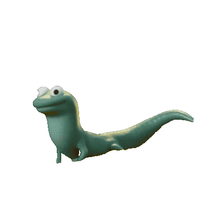
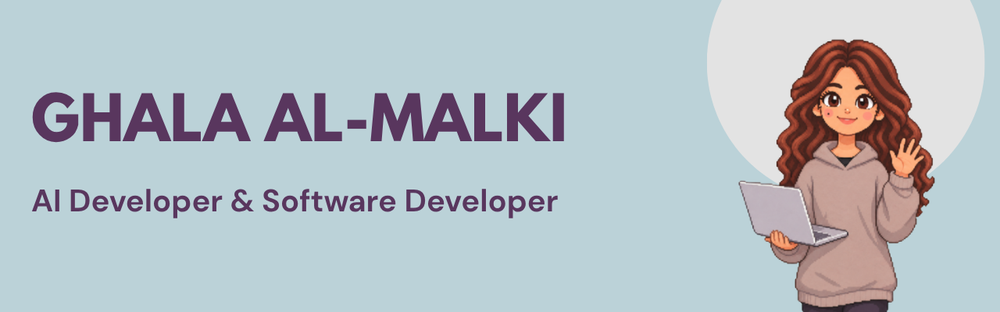
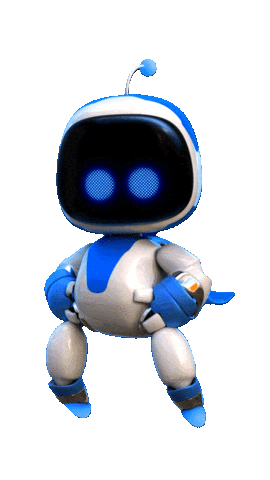

# Hello, I'm Ghala 

I tend to turn my random ideas into coding projects.

I enjoy creating useful things, solving problems, and occasionally building something just for fun. For me, coding is a way to bring ideas to life and explore possibilities I wouldn't have thought of otherwise.

I'm interested in AI, especially building applications that combine AI with real-world ideas.

**Some things I work with:** Python, Prompt Engineering, C#, JavaScript, HTML, and more.

## Featured Project

**HakayTech** · AI Companion for an Educational Game

An educational Unity game that teaches kids block-based programming through Saudi cultural stories. I developed the AI companion, focusing on adaptive hints, response validation, conversation memory, and Arabic text-to-speech.

## Find Me Around the Web 🌎:

[LinkedIn](https://linkedin.com/in/ghala-almalki) · [Email](mailto:ghala.almalki.cs@gmail.com)
